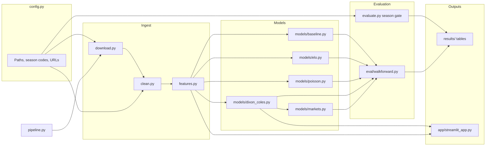

# Premier League Prediction Engine

Historical Premier League results and bookmaker odds are messy to turn into a fair, repeatable forecast demo. This project downloads those CSVs, cleans them, fits simple match-outcome models, evaluates them on a fixed test set against the market, and shows the results in Streamlit.

This is a **forecast / engineering demo**, not a betting tipster or gambling product.


## Architecture



Dixon–Coles is the product goals engine: one time-decayed scoreline grid feeds 1X2, BTTS, and over/under 2.5. Independent Poisson and Elo are 1X2 comparators; the sklearn baseline sits next to the bookmaker line.

More detail: [docs/CASE_STUDY.md](docs/CASE_STUDY.md) · [docs/SCOPE.md](docs/SCOPE.md) · [docs/EVAL_PROTOCOL.md](docs/EVAL_PROTOCOL.md)

## Project layout

```text
app/           Streamlit dashboard
src/           Library code (download, clean, features, models, evaluate, pipeline)
src/models/    Dixon–Coles, markets, Poisson, Elo, baseline, predict helper
src/eval/      Walk-forward folds, calibration
tests/         pytest suite
data/raw/      Downloaded CSVs (gitignored)
data/processed/  Cleaned matches (gitignored)
results/       Eval tables (committed); walk-forward is research SoT
docs/          Scope, case study, eval protocol, dashboard screenshot
SYLLABUS.md    Teaching syllabus + future-scope epics
```

## Setup (macOS / Linux / Windows)

1. Clone the repo and create a virtual environment:

```bash
git clone https://github.com/LeonardJennnings/premier-league-prediction-engine.git
cd premier-league-prediction-engine
python3 -m venv .venv
```

2. Activate it:

```bash
# macOS / Linux
source .venv/bin/activate

# Windows PowerShell
.venv\Scripts\Activate.ps1
```

3. Install dependencies:

```bash
python -m pip install -r requirements.txt
```

4. (Optional) copy the env template — never commit `.env`:

```bash
cp .env.example .env
```

`LOG_LEVEL` defaults to `INFO`. `FOOTBALL_DATA_ORG_TOKEN` is for a later fixtures API and can stay empty.

## Pipeline

From the project root, with the venv active:

```bash
python -m src.pipeline
```

This downloads (or skips) raw CSVs, builds `data/processed/matches.csv`, fits the models, and prints a sample comparison.

## Evaluation

```bash
# Season gate (fixed 2526 holdout)
python -m src.evaluate --mode season

# Gameweek walk-forward (primary research protocol; slower)
python -m src.evaluate --mode walkforward
```

Season mode writes `results/eval_results.csv`. Walk-forward writes `results/walkforward_*.csv`, calibration plots, and `results/WALKFORWARD.md`. Walk-forward scores Dixon–Coles (raw and temperature-calibrated 1X2), Elo, independent Poisson, book 1X2, plus binary Dixon–Coles over/under 2.5 and BTTS from the same grid, and book over/under 2.5 when those columns exist. Binary market rows are labelled `market=over_under_25` / `market=btts` and must not be ranked against 1X2 log loss. See [`docs/EVAL_PROTOCOL.md`](docs/EVAL_PROTOCOL.md) and `results/EVAL_README.md`.

## Results

**Research source of truth is gameweek walk-forward** (`python -m src.evaluate --mode walkforward`), not the fixed season gate below. Prefer `results/walkforward_summary.csv` (pooled proper scores) and [`docs/EVAL_PROTOCOL.md`](docs/EVAL_PROTOCOL.md) for research claims. The `2526` table is a regression smoke check only.

Season-gate smoke check: train on seasons `2223`–`2425` (1,140 matches), test on `2526` (380 matches with closing odds). Lower log loss / Brier is better.

| Model | Log loss | Brier | Accuracy |
|-------|----------|-------|----------|
| Naive frequencies | 1.085 | 0.219 | 42.6% |
| Poisson | 1.041 | 0.209 | 45.0% |
| Dixon–Coles | 1.033 | 0.207 | 47.1% |
| Elo | 1.042 | 0.208 | 46.6% |
| Sklearn baseline | 1.016 | 0.204 | 49.5% |
| Bookmaker implied | 1.013 | 0.203 | 49.7% |

**Reading:** every model beats a naive “always use historical H/D/A rates” baseline. Dixon–Coles improves a little on independent Poisson; Elo sits in the same band as Poisson. The sklearn baseline lands very close to the bookmaker row. That is an honest engineering result — matching closing odds is hard, and a dramatic unexplained win would be more suspicious than useful. Full numbers live in `results/eval_results.csv`.

## Dashboard

```bash
streamlit run app/streamlit_app.py
```

Run from the **project root**. Open the local URL Streamlit prints (usually http://localhost:8501).

## Docker

Requires [Docker Desktop](https://www.docker.com/products/docker-desktop/). Build once from the project root:

```bash
docker build -t pl-engine .
```

**Data:** the image does not include `data/raw/` (and should not redistribute those files). Run the local pipeline first so `data/processed/matches.csv` exists, then **mount** your laptop’s `data/` (and optionally `results/`) into the container:

```bash
docker run --rm -p 8501:8501 \
  -v "$PWD/data:/app/data" \
  -v "$PWD/results:/app/results" \
  pl-engine
```

Open http://localhost:8501. `-p 8501:8501` publishes the Streamlit port; `-v` means the container reads/writes your local folders instead of baking stale data into the image. Stop with Ctrl+C.

## Tests

```bash
pytest
```

## Demo

Record a ~2 minute screen walkthrough (README → app → one match → eval table) and host it unlisted on Loom or YouTube. Add the link here when you have it:

**Demo video:** _add Loom/YouTube URL_

## Optional deploy

[Streamlit Community Cloud](https://streamlit.io/cloud) can host `app/streamlit_app.py` from this GitHub repo. Put secrets in the Cloud secrets UI, not in Git. The deployed app still needs processed data available somehow (committed sample, build step, or documented download) — see the case study if you extend this.

## Data

Match results and odds are from [football-data.co.uk](https://www.football-data.co.uk/).
Column meanings: [notes.txt](https://www.football-data.co.uk/notes.txt).
Raw CSVs live in `data/raw/` and are not committed to Git. This project does **not** claim a licence over that source data.

## Licence

Project code is under the [MIT License](LICENSE). football-data.co.uk data remains subject to that site’s terms; do not treat the CSVs as yours to redistribute.
