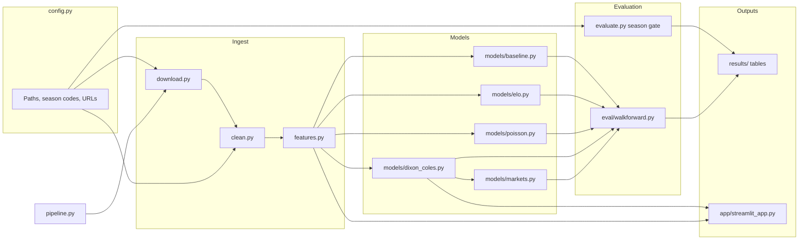

# Premier League Prediction Engine

Historical Premier League results and bookmaker odds are messy to turn into a fair, repeatable forecast demo. This project downloads those CSVs, cleans them, fits simple match-outcome models, evaluates them on a fixed test set against the market, and shows the results in Streamlit.

This is a **forecast / engineering demo**, not a gambling product.


## Architecture



Dixon–Coles is the product goals engine: one time-decayed scoreline grid feeds 1X2, BTTS, and over/under 2.5. Independent Poisson and Elo are 1X2 comparators; the sklearn baseline sits next to the bookmaker line.

More detail: [docs/CASE_STUDY.md](docs/CASE_STUDY.md) · [docs/SCOPE.md](docs/SCOPE.md) · [docs/EVAL_PROTOCOL.md](docs/EVAL_PROTOCOL.md)

## Project layout

```text
app/           Streamlit dashboard (lab)
web/           Public Astro site (weekend / past / how-it-works)
src/           Library code (download, clean, features, models, evaluate, jobs, pipeline, api)
src/api/       Thin read-only Predictions API (Epic 4)
src/models/    Dixon–Coles, markets, Poisson, Elo, baseline, predict helper
src/eval/      Walk-forward folds, calibration
src/jobs/      Fit, publish, settle, precompute
tests/         pytest suite
data/raw/      Downloaded CSVs (gitignored)
data/processed/  Cleaned matches + predictions.sqlite (gitignored)
data/reference/  Committed team-name map
results/       Eval tables (committed); walk-forward is research SoT
docs/          Scope, case study, eval protocol, specs, notes
SYLLABUS.md    Teaching syllabus + future-scope epics
```

## Setup (macOS / Linux / Windows)

1. Clone the repo and create a virtual environment:

```bash
git clone https://github.com/LeonardJennnings/premier-league-prediction-engine.git
cd premier-league-prediction-engine
python3 -m venv .venv
```

2. Activate it:

```bash
# macOS / Linux
source .venv/bin/activate

# Windows PowerShell
.venv\Scripts\Activate.ps1
```

3. Install dependencies:

```bash
python -m pip install -r requirements.txt
```

4. (Optional) copy the env template — never commit `.env`:

```bash
cp .env.example .env
```

`LOG_LEVEL` defaults to `INFO`. `FOOTBALL_DATA_ORG_TOKEN` is required for `publish`, `settle`, and `precompute`. Leave it empty if you only run the historical pipeline. `API_CORS_ORIGINS` defaults to Astro (`http://localhost:4321`) plus `http://localhost:3000` for the Predictions API.

## Pipeline

From the project root, with the venv active:

```bash
python -m src.pipeline
```

This downloads (or skips) raw CSVs, builds `data/processed/matches.csv`, fits the models, and prints a sample comparison.

## Fixtures, fit, and settlement

`publish` and `settle` read Premier League fixtures from football-data.org. Put `FOOTBALL_DATA_ORG_TOKEN` in `.env` before those commands. `fit` uses the local historical match table and does not call that API.

```bash
# requires FOOTBALL_DATA_ORG_TOKEN in .env
python -m src.jobs.fit
python -m src.jobs.publish
python -m src.jobs.settle
# or
python -m src.jobs.precompute
```

`fit` writes a versioned Dixon–Coles artefact under `models/` and registers it in the prediction database. `publish` loads that artefact (the latest one, when no version is chosen), refetches the next 10 days of fixtures, maps team names, and inserts one row per match and model version. Each publish skips the fixture-cache read, so a same-day postponement or a newly listed match is visible on the next run. A successful response still overwrites `data/raw/fixtures/` for inspection. Stored kickoffs are those in `[now, now + 10 days)`. football-data.org treats `dateTo` as exclusive, so the request end date is the following day. New rows from one publish commit together. A duplicate `(match_id, model_version)` is skipped and its probabilities stay as first inserted. `precompute` runs `fit` and then `publish` as two steps. It does not settle.

Probability columns are immutable after insert. `settle` refetches the kickoff span of scheduled, postponed, and already settled rows, and it skips the fixture-cache read as well. It writes full-time goals, the H/D/A result, `settled_at`, and `status`. A later `FINISHED` payload with different goals corrects the score and result. `POSTPONED` and `SUSPENDED` set status `postponed`; `CANCELLED` sets `cancelled`. A new `utcDate` updates `kickoff_utc`. Settle does not change probabilities or book columns, and it does not insert a row for a match that was never published. A revised forecast is a new model version.

football-data.org names must appear in `data/reference/team_name_map.json`. An unmapped name, or a team missing from the artefact, aborts the publish batch. After mapping, publish tries to fill `book_*` from the free [football-data.co.uk fixtures list](https://www.football-data.co.uk/fixtures.csv): Bet365 1X2, plus over/under 2.5 when both prices are present, de-vigged the same way as historical closing odds. A filled row sets `book_source` to `football-data.co.uk fixtures.csv (B365)`. If the download fails, the file has no Premier League rows, or the home team, away team, and date do not match, those columns stay null.

Snapshot freshness, the manual Actions refresh, and the shared `FOOTBALL_DATA_ORG_TOKEN` name are in [docs/OPS_CADENCE.md](docs/OPS_CADENCE.md). CI does not read that token.

## Predictions API

Read-only FastAPI surface over the SQLite prediction store (no fit/predict on the request path).

```bash
uvicorn src.api.app:app --reload
```

Open http://127.0.0.1:8000/docs for OpenAPI. Endpoints: `GET /health`, `GET /v1/predictions/upcoming`, `GET /v1/predictions/weeks`, `GET /v1/predictions/weeks/{iso_week}`, `GET /v1/models/latest`, `GET /v1/models/{model_version}`. Optional `?model_version=` pin. Requires a populated `data/processed/predictions.sqlite` from `fit` / `publish` / `settle`.

CORS allow-list is `API_CORS_ORIGINS` (comma-separated; default includes Astro on `:4321` and `:3000`).

## Public site (Epic 5)

Static Astro app under [`web/`](web/) — weekend slate, past scorecard, how-it-works. See [`web/README.md`](web/README.md).

```bash
cd web && npm install && npm run dev
```

Set `PUBLIC_PREDICTIONS_API_BASE` (default `http://127.0.0.1:8000`) in `web/.env`.

## Evaluation

```bash
# Season gate (fixed 2526 holdout)
python -m src.evaluate --mode season

# Gameweek walk-forward (primary research protocol; slower)
python -m src.evaluate --mode walkforward

# Nested ξ tune (older folds → freeze → recent holdout)
python -m src.evaluate --mode xi_tune
```

Season mode writes `results/eval_results.csv`. Walk-forward writes `results/walkforward_*.csv`, calibration plots, and `results/WALKFORWARD.md`. Walk-forward scores Dixon–Coles (raw and temperature-calibrated 1X2), Elo, independent Poisson, book 1X2 (closing + opening), Dixon–Coles + closing-book blend, binary Dixon–Coles over/under 2.5 and BTTS from the same grid, book over/under 2.5 (close/open) when those columns exist, and **lab-only** specialised O/U comparators (`poisson_total_over_25`, optional calibrated sibling, `totals_logistic_over_25`). Grid-derived O/U remains the product default for publish and UI. Binary market rows are labelled `market=over_under_25` / `market=btts` and must not be ranked against 1X2 log loss. ξ tune writes `results/xi_tune_*.csv` and `results/XI_TUNE.md` (see nested protocol in [`docs/EVAL_PROTOCOL.md`](docs/EVAL_PROTOCOL.md)). See also [`docs/notes/2026-11-16-ou-lab-decision.md`](docs/notes/2026-11-16-ou-lab-decision.md) and `results/EVAL_README.md`.

## Results

**Research source of truth is gameweek walk-forward** (`python -m src.evaluate --mode walkforward`), not the fixed season gate below. Prefer `results/walkforward_summary.csv` (pooled proper scores) and [`docs/EVAL_PROTOCOL.md`](docs/EVAL_PROTOCOL.md) for research claims. The `2526` table is a regression smoke check only.

Season-gate smoke check: train on seasons `2223`–`2425` (1,140 matches), test on `2526` (380 matches with closing odds). Lower log loss / Brier is better.

| Model | Log loss | Brier | Accuracy |
|-------|----------|-------|----------|
| Naive frequencies | 1.085 | 0.219 | 42.6% |
| Poisson | 1.041 | 0.209 | 45.0% |
| Dixon–Coles | 1.033 | 0.207 | 47.1% |
| Elo | 1.042 | 0.208 | 46.6% |
| Sklearn baseline | 1.016 | 0.204 | 49.5% |
| Bookmaker implied | 1.013 | 0.203 | 49.7% |

**Reading:** every model beats a naive “always use historical H/D/A rates” baseline. Dixon–Coles improves a little on independent Poisson; Elo sits in the same band as Poisson. The sklearn baseline lands very close to the bookmaker row. That is an honest engineering result — matching closing odds is hard, and a dramatic unexplained win would be more suspicious than useful. Full numbers live in `results/eval_results.csv`.

## Dashboard

```bash
streamlit run app/streamlit_app.py
```

Run from the **project root**. Open the local URL Streamlit prints (usually http://localhost:8501).

## Docker

Requires [Docker Desktop](https://www.docker.com/products/docker-desktop/). Build once from the project root:

```bash
docker build -t pl-engine .
```

**Data:** the image does not include `data/raw/` (and should not redistribute those files). Run the local pipeline first so `data/processed/matches.csv` exists, then **mount** your laptop’s `data/` (and optionally `results/`) into the container:

```bash
docker run --rm -p 8501:8501 \
  -v "$PWD/data:/app/data" \
  -v "$PWD/results:/app/results" \
  pl-engine
```

Open http://localhost:8501. `-p 8501:8501` publishes the Streamlit port; `-v` means the container reads/writes your local folders instead of baking stale data into the image. Stop with Ctrl+C.

## Tests

```bash
pytest
```

## Demo

Record a ~2 minute screen walkthrough (README → app → one match → eval table) and host it unlisted on Loom or YouTube. Add the link here when you have it:

**Demo video:** _add Loom/YouTube URL_

## Optional deploy

[Streamlit Community Cloud](https://streamlit.io/cloud) can host `app/streamlit_app.py` from this GitHub repo. Put secrets in the Cloud secrets UI, not in Git. The deployed app still needs processed data available somehow (committed sample, build step, or documented download) — see the case study if you extend this.

## Data

Match results and odds are from [football-data.co.uk](https://www.football-data.co.uk/).
Column meanings: [notes.txt](https://www.football-data.co.uk/notes.txt).
Raw CSVs live in `data/raw/` and are not committed to Git. This project does **not** claim a licence over that source data.

## Licence

Project code is under the [MIT License](LICENSE). football-data.co.uk data remains subject to that site’s terms; do not treat the CSVs as yours to redistribute.
