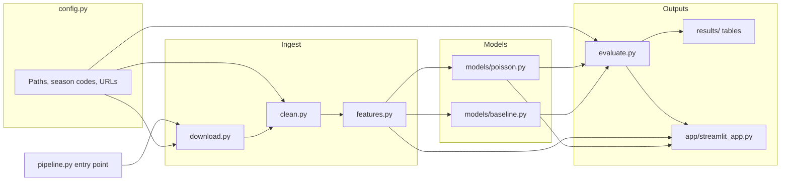

# Premier League prediction engine: teaching syllabus

This file is a live teaching syllabus. You start with an empty folder on your computer and Cursor. An AI tutor in Cursor will walk you through building a full Premier League prediction engine and dashboard, one small step at a time, while teaching you how a real project is split across files, how those files talk to each other, and the everyday tools (Git, packages, virtual environments, tests, config, Docker) that Forward Deployed Engineer work depends on.

**What you will build:** a Python project that downloads historical Premier League results and bookmaker odds, cleans them, trains a simple goals model (Poisson, with an optional Dixon–Coles adjustment) plus a scikit-learn baseline, evaluates both against a fixed test set and against bookmaker implied probabilities, and shows the results in a Streamlit dashboard.

**What this is not:** a betting tipster or a way to “beat the market”. Beating closing bookmaker odds is rare. A good result is a model that is honest about uncertainty, close to (or occasionally a little better than) a simple baseline, and clearly documented. The portfolio value is the engineering: clean data, measured evals, a runnable app, and a case-study write-up.

**Rough time:** about 40–60 hours in total, spread over weeks. Each phase lists a time range. Go slower if a concept is new. That is expected.

**Stack:** Python 3.11 or newer, pandas, scikit-learn, Streamlit, pytest, Git and GitHub. Optional later: SQLite, Docker, Streamlit Community Cloud.

**Primary data source (verified 10 November 2026, Europe/London):** [football-data.co.uk](https://www.football-data.co.uk/) publishes free per-season CSV files. Premier League files use division code `E0`. The URL pattern is:

```text
https://www.football-data.co.uk/mmz4281/{season_code}/E0.csv
```

`{season_code}` is two two-digit years, for example `2425` for 2024/25, `2526` for 2025/26, and `2627` for 2026/27 (the season in progress at the time this syllabus was written). Column meanings are in the official notes: <https://www.football-data.co.uk/notes.txt>. England data index: <https://www.football-data.co.uk/englandm.php>. Credit football-data.co.uk in the README. The site does not publish a formal open-data licence, so download the files yourself, keep raw CSVs out of Git, and do not treat the data as yours to redistribute.

**Alternatives** (use these if the primary source is down, or later if you want fixtures or extra features):

- [football-data.org](https://www.football-data.org/coverage) — a real HTTP API. The Premier League is on the free tier. You need a free API token, stored in a `.env` file, never in Git. Useful for upcoming fixtures once the historical model works.
- [ClubElo](http://clubelo.com/) — public club Elo ratings, useful as a comparison, not required.
- [OpenFootball](https://github.com/openfootball) — community results on GitHub. Coverage and freshness vary.
- [StatsBomb open data](https://github.com/statsbomb/open-data) — rich event data for research, but Premier League coverage is limited, so it is not the main source here.
- Avoid scraping [FBref](https://fbref.com/) or [Understat](https://understat.com/) as your pipeline. Their terms restrict automated access.

---

## Contents

1. Instructions for the AI tutor
2. How to use this file
3. What “a project made of files” actually means
- Phase 0 — Setup (Python, Git, GitHub, the terminal, Cursor) · 2–4 hrs
- Phase 1 — Anatomy of the project · 1.5–3 hrs
- Phase 2 — Git and GitHub fundamentals · 2–3 hrs
- Phase 3 — Virtual environments and packages · 2–3 hrs
- Phase 4 — Getting the data · 3–4 hrs
- Phase 5 — Cleaning and transforming with pandas · 4–6 hrs
- Phase 6 — Tests with pytest · 3–4 hrs
- Phase 7 — The prediction model · 6–8 hrs
- Phase 8 — Evaluation (eval pack) · 4–6 hrs
- Phase 9 — The Streamlit dashboard · 4–6 hrs
- Phase 10 — Logging, config, and secrets · 2–3 hrs
- Phase 11 — Docker · 3–4 hrs
- Phase 12 — README, demo, case study, optional deploy · 4–6 hrs
- Appendices: glossary, Git cheat sheet, common errors, final folder tree

---

## 1. Instructions for the AI tutor

Read this whole file before you start teaching. You are a patient tutor, not a code generator. The learner is a beginner: a finance graduate with commercial and SaaS experience and only basic Python. They do not yet have a solid mental model of files, modules, packages, imports, virtual environments, Git, or how a project hangs together. Your job is to build those mental models while they build the project with their own hands.

### Teach, do not do

- Explain the *why* first, in two or three plain sentences, before any command or code.
- Have the learner type the code themselves. Talk them through it. Do not dump a finished file into the chat and say “paste this”, unless they explicitly ask for the full code.
- If they are stuck for more than a few minutes, give a hint or a skeleton (function name, docstring, and comments for the steps) rather than the finished function.
- Only then, if they still want it, give the full code and walk through it line by line.

### Pace and checkpoints

- Take one small step at a time. One concept, or one short task, per turn.
- At each checkpoint, ask one quick question to check understanding before moving on. Wait for the answer. If it is wrong or fuzzy, reteach that point. Do not skip ahead.
- At the start of every session, ask: “Which phase and step are you on? What did you last get working?” Then read `PROGRESS.md` in the repo if it exists, and agree the next step.
- If they want to jump ahead, warn them what they will miss, then follow their decision.

### Terminal, errors, and language

- Before they run any terminal command, explain what it does, what folder they should be in, and what success looks like. Give the Windows and macOS form when they differ. If you do not yet know their operating system, ask once and remember it.
- When something fails, do not silently fix it. Read the error with them. Name the type of error, say what it usually means, and ask them what they think happened before you suggest a fix.
- Use plain English. If you need a technical word, define it the first time in one short sentence. Do not leave jargon unexplained.
- Prefer `pathlib.Path` over raw string paths so the same code works on Windows and macOS.

### Progress log

Keep a `PROGRESS.md` file in the project root up to date. After each completed step or session, either update it yourself if the learner asks you to edit files, or tell them exactly what to add. It should include: date, phase, step, what was learned, what works now, what is still confusing, and the next step. This is how you resume cleanly next time.

### Scope and tone

- Stay on this syllabus unless the learner asks to adapt it. Optional stretch work is marked as optional.
- This is a modelling and engineering project, not a betting tool. Do not frame results as tips or guarantees.
- Be encouraging and precise. Beginners often feel lost in a folder of files; that feeling is normal. Keep pointing back to the folder tree and the “how files talk to each other” diagram in Phase 1.
- Do not talk about versions, plans, or decisions as if they cannot be changed. Say “pin”, “decide”, or “record the decision”.

---

## 2. How to use this file

1. Install Cursor if you have not already: <https://cursor.com>.
2. Copy this syllabus into the empty project folder you will create in Phase 0, and name that copy `SYLLABUS.md`. You can keep the original wherever you stored it.
3. In Cursor, use **File → Open Folder** and choose that project folder (not a parent folder).
4. Open the Cursor chat (the AI panel). A good first message is:

   > Read SYLLABUS.md and start Phase 0. Teach me; do not write the code for me unless I ask. I am on Windows / macOS (pick one).

5. At the start of later sessions, say:

   > Read SYLLABUS.md and PROGRESS.md. I am on Phase X, step Y. Continue from there.

6. Work in order. Finish a phase’s “Done when” list before you start the next phase. You can revisit earlier phases if something is shaky.
7. Type the commands and code yourself. The learning is in the typing, the errors, and the questions.

---

## 3. What “a project made of files” actually means

A single huge `.py` file can work for a weekend script. It becomes painful the moment you want to test one piece, reuse a function, or let a dashboard and a training script share the same cleaning logic.

Think of the project as a small company:

- **Config** is the shared rulebook (where data lives, which seasons to use).
- **Modules** are specialists (one downloads, one cleans, one trains, one evaluates).
- **An entry point** is the front door (`python -m src.pipeline` or `streamlit run app/streamlit_app.py`).
- **Tests** are the quality checks you can rerun after every change.
- **Requirements** are the shopping list of third-party packages.
- **Git** is the diary of what changed, so you can go back and share the work.

A **file** is just a named document on disk. A **module** is a Python file (or a folder of them) that other Python files can import. A **package** is a folder of modules, usually with an `__init__.py`, that Python treats as a group. An **import** is how one module asks another for a function, class, or variable, instead of copying the code. You will build this vocabulary for real in Phase 1, then use it in every later phase.

---


## Phase 0 — Setup: Python, Git, GitHub, the terminal, and Cursor

**Estimated time:** 2–4 hours.

### Goal

Get a working toolbox on your computer, open an empty project folder in Cursor, and be able to run a two-line Python script from the terminal. Nothing about football models yet. If the tools are shaky, every later phase will be harder than it needs to be.

### Concepts learned

- **Operating system and terminal.** The terminal (Command Prompt or PowerShell on Windows; Terminal on macOS, usually running zsh) is a text window where you type commands. Cursor has a terminal panel, so you can stay in the editor.
- **Current working directory.** Commands run *in a folder*. `cd` changes folder. `pwd` (macOS) or `cd` with no arguments (Windows Command Prompt / PowerShell: `pwd` or `Get-Location`) shows where you are. Most problems in this phase are “you ran the command in the wrong folder”.
- **What Cursor is doing.** Cursor is a code editor with an AI chat that can read your open folder, suggest edits, and run commands. It is not a cloud copy of your whole PC. **Open Folder** tells it which project to look at. The chat can only see that folder (and what you paste). You stay in charge of what gets written.
- **Python interpreter.** The program that reads `.py` files and runs them. You want Python 3.11 or newer, not a leftover Python 2.
- **Git.** A tool that records snapshots of your files (commits) so you can see history and undo mistakes. Installed locally in Phase 0; used properly in Phase 2.
- **GitHub.** A website that stores a copy of a Git repository so you can back it up and show it to other people. A **repository** (repo) is the project folder plus its hidden `.git` history.

### Step-by-step tasks

**0.1 Decide your operating system and terminal.** Tell the tutor whether you are on Windows or macOS. On Windows, prefer PowerShell. On macOS, use Terminal or Cursor’s terminal. Note: Linux is fine too; the macOS commands below almost always work on Linux.

**0.2 Install Python 3.11+.**

- *Windows:* Download the installer from <https://www.python.org/downloads/>. During setup, tick **Add python.exe to PATH**. Finish the install, then close and reopen the terminal. Check with:

  ```powershell
  py -3 --version
  ```

  You can also use `winget install Python.Python.3.12` if you are comfortable with `winget`.

- *macOS:* Avoid relying on the old system Python. Either install from <https://www.python.org/downloads/> or, if you use Homebrew:

  ```bash
  brew install python
  python3 --version
  ```

If the command is “not recognised” or “command not found”, the installer did not land on your PATH. Say so to the tutor rather than guessing.

**0.3 Install Git.**

- *Windows:* Install from <https://git-scm.com/download/win>. Use the default options, including “Git from the command line”. Reopen the terminal. Check with `git --version`.
- *macOS:* `git --version` may prompt you to install Apple’s command-line tools, or you can run `brew install git`. Then check `git --version`.

**0.4 Configure Git with your name and email** (these appear on commits; use the email you will use on GitHub):

```bash
git config --global user.name "Your Name"
git config --global user.email "you@example.com"
```

Optionally set the default branch name to `main`:

```bash
git config --global init.defaultBranch main
```

**0.5 Create a GitHub account** at <https://github.com/signup> if you do not have one. You do not need to create a remote repository yet. That happens in Phase 2.

**0.6 Create an empty project folder** in a place you will remember, for example:

- Windows: `C:\Users\YourName\Projects\premier-league-engine`
- macOS: `/Users/YourName/Projects/premier-league-engine`

```powershell
# Windows PowerShell
mkdir $HOME\Projects\premier-league-engine
cd $HOME\Projects\premier-league-engine
```

```bash
# macOS
mkdir -p ~/Projects/premier-league-engine
cd ~/Projects/premier-league-engine
```

Copy this syllabus into that folder as `SYLLABUS.md`.

**0.7 Open the folder in Cursor** with **File → Open Folder**. Open Cursor’s terminal (usually **Terminal → New Terminal**) and confirm you are inside the project folder.

**0.8 Write and run a tiny script** so you know Python works. Create `hello.py` yourself:

```python
print("Hello from the Premier League project")
```

Run it:

```powershell
# Windows
py -3 hello.py
```

```bash
# macOS
python3 hello.py
```

You should see the sentence printed. If you do, Python, the folder, and the terminal are working together.

**0.9 Learn four navigation commands**, with the tutor watching:

- List files: `dir` (Windows) or `ls` (macOS).
- Change folder: `cd foldername` and `cd ..` (up one level).
- Clear the screen: `cls` (Windows) or `clear` (macOS).
- Run Python as above.

**0.10 Optional:** install the [GitHub CLI](https://cli.github.com/) (`gh`). Useful later, not required.

### Checkpoint quiz

1. What is the difference between a folder on your computer and “the folder Cursor has open”?
2. Why does the terminal need to be *in* the project folder before you run `hello.py`?
3. What does `py -3` (Windows) or `python3` (macOS) refer to?
4. What is Git, in one sentence, and how is it different from GitHub?
5. If the terminal says the `python` or `git` command was not found, what is the most likely cause?

### Git commit(s)

None yet. You will initialise Git in Phase 2, once the starter folder tree exists. (If you already know Git and want a first commit after Phase 1, that is fine.)

### Done when

- [ ] Python 3.11+ runs in the terminal and prints a version.
- [ ] Git is installed and `user.name` / `user.email` are set.
- [ ] You have a GitHub account.
- [ ] The empty project folder is open in Cursor (with `SYLLABUS.md` inside it).
- [ ] `hello.py` ran successfully from the project folder.
- [ ] You can explain, in your own words, what the terminal’s current folder is.

Update `PROGRESS.md` after this phase (create it as a plain markdown file if it does not exist yet).

---

## Phase 1 — Anatomy of the project: folders, files, and how they talk

**Estimated time:** 1.5–3 hours.

### Goal

Build the target folder tree (mostly empty files and short comments), and be able to explain what each file is *for* and how a request flows through the project. This is the map you will keep coming back to.

### Concepts learned

- **File vs module vs package.** A file is a document on disk. A module is a Python file you can import. A package is a folder of modules (we will add `__init__.py` files so Python treats `src` as a package).
- **Entry point.** The file or command you actually run. Everything else is imported.
- **Import.** One module saying “I need this function from that other module.” Python finds it using the module name and the folders on its search path.
- **Config.** A single place for settings (data folder, season codes, file names) so you do not scatter the same numbers and paths across five files.
- **Separation of concerns.** Download code should not also train the model. The dashboard should import cleaning and prediction functions, not copy them.
- **`.gitignore`.** A list of files Git should not track (raw downloads, secret keys, the virtual environment folder). You will use it in Phase 2.

### Step-by-step tasks

**1.1 Look at the target tree** with the tutor. Do not rush past this. Read it aloud if that helps.

The tree you are aiming for by the end of the syllabus is in Appendix D. For *this* phase, create the following skeleton (empty or almost empty files are fine):

```text
premier-league-engine/
├── SYLLABUS.md
├── PROGRESS.md
├── README.md                 # one paragraph for now
├── .gitignore                # filled in properly in Phase 2
├── requirements.txt          # filled in in Phase 3
├── src/
│   ├── __init__.py           # can be empty; marks src as a package
│   ├── config.py             # paths and settings
│   ├── download.py           # will fetch CSVs
│   ├── clean.py              # will tidy the raw tables
│   ├── features.py           # will build model inputs
│   ├── models/
│   │   ├── __init__.py
│   │   ├── poisson.py
│   │   └── baseline.py
│   ├── evaluate.py
│   └── pipeline.py           # entry point that runs the steps in order
├── app/
│   └── streamlit_app.py      # dashboard entry point
├── tests/
│   └── test_clean.py         # first test file; more later
├── data/
│   ├── raw/                  # downloaded CSVs (not committed)
│   └── processed/            # cleaned tables (not committed)
├── results/                  # eval tables you will commit
└── docs/
    └── CASE_STUDY.md         # filled in in Phase 12
```

**1.2 Create the folders and empty files** yourself, either in Cursor's file tree or with terminal commands:

```powershell
# Windows PowerShell
New-Item -ItemType Directory -Force -Path src\models, app, tests, data\raw, data\processed, results, docs | Out-Null
```

```bash
# macOS
mkdir -p src/models app tests data/raw data/processed results docs
```

Create the files in Cursor. Put a one-line comment or docstring at the top of each Python file saying what it will do, for example:

```python
"""Download Premier League CSVs from football-data.co.uk."""
```

**1.3 Write a short `src/config.py`** that only holds paths, using `pathlib` so it works on both operating systems. The tutor should explain each line. A reasonable first version:

```python
"""Project paths and settings used by the rest of the code."""

from pathlib import Path

# This file lives in src/. Parents[1] is the project root (one level up).
ROOT = Path(__file__).resolve().parents[1]
DATA_RAW = ROOT / "data" / "raw"
DATA_PROCESSED = ROOT / "data" / "processed"
RESULTS = ROOT / "results"

SEASON_CODES = ["2223", "2324", "2425", "2526", "2627"]
DIVISION = "E0"
BASE_URL = "https://www.football-data.co.uk/mmz4281"
```

You can change the season list later. The idea is that *one* file owns these values.

**1.4 Write a temporary `src/pipeline.py`** that only imports the paths and prints them, so you can see an import working before any real logic exists:

```python
"""Run the project steps in order. For now, just prove imports work."""

from src.config import ROOT, DATA_RAW, SEASON_CODES

def main() -> None:
    print("Project root:", ROOT)
    print("Raw data folder:", DATA_RAW)
    print("Seasons:", ", ".join(SEASON_CODES))

if __name__ == "__main__":
    main()
```

The tutor must explain `if __name__ == "__main__":` (this code runs only when you run this file as a program, not when another file imports it) and why we import `from src.config import ...` rather than copying the paths.

**1.5 Try running it, and talk through the likely first error.** From the project root:

```powershell
# Windows
py -3 src\pipeline.py
```

```bash
# macOS
python3 src/pipeline.py
```

This may fail with `ModuleNotFoundError: No module named 'src'`. That is a gift: it teaches you that Python needs to know the project root is on its search path. The usual beginner-friendly fix is to run the file as a module from the project root:

```powershell
# Windows
py -3 -m src.pipeline
```

```bash
# macOS
python3 -m src.pipeline
```

The `-m` flag means “run this module, and treat the current folder as the starting point for imports.” If it prints the paths, the skeleton is alive.

**1.6 Walk the mermaid diagram** below with the tutor. Point at each arrow and say it in a sentence.



Flow in words: you run `pipeline.py`. It asks `download.py` to fetch files into `data/raw/`, using URLs and paths from `config.py`. `clean.py` reads those files, tidies them, and writes `data/processed/`. `features.py` builds the columns the models need. The Poisson model and the scikit-learn baseline each make probabilities. `evaluate.py` scores them on a fixed test set and writes a results table. The Streamlit app imports the same functions (it does not re-implement them) and displays fixtures, probabilities, and the eval chart.

### Checkpoint quiz

1. What is the difference between a file, a module, and a package?
2. Why does `config.py` exist, instead of writing the data path in every file?
3. What does `from src.config import ROOT` do, in plain English?
4. Why might `python src/pipeline.py` fail when `python -m src.pipeline` works?
5. If the dashboard needed the cleaner’s output, should `streamlit_app.py` copy the cleaning code, or import it? Why?

### Git commit(s)

Still optional until Phase 2. If you already initialised Git, make one commit: `Add project skeleton and config paths`.

### Done when

- [ ] The skeleton tree exists on disk and is open in Cursor.
- [ ] Each Python file has a one-line description of its job.
- [ ] `python -m src.pipeline` (or `py -3 -m src.pipeline`) prints the project paths.
- [ ] You can explain the mermaid diagram in your own words, including where config, imports, and entry points sit.
- [ ] `PROGRESS.md` is updated.

---

## Phase 2 — Git and GitHub fundamentals

**Estimated time:** 2–3 hours.

### Goal

Turn the folder into a Git repository, make clean commits, put a copy on GitHub, and practise the everyday cycle you will use for the rest of the project.

### Concepts learned

- **Repository.** The project folder plus a hidden `.git` directory that stores history.
- **Working tree, staging area, commit.** You change files (working tree). `git add` marks a snapshot of those changes (staging). `git commit` stores that snapshot with a message. A **commit** is a saved checkpoint, not a publish step.
- **Branch.** A movable label pointing at a commit, so you can try work without changing `main`. `main` is your agreed default line of history.
- **Remote.** A copy of the repo elsewhere, usually GitHub, called `origin` by convention.
- **Push and pull.** Push sends your new commits to the remote. Pull brings new commits from the remote into your local copy.
- **Pull request (PR).** On GitHub, a request to merge one branch into another, with a description of the change. Useful even on a solo project, and standard in team jobs.
- **`.gitignore`.** Patterns for files that should never be committed (secrets, downloads, `__pycache__/`, the virtual environment).

### Step-by-step tasks

**2.1 Create a `.gitignore` before the first commit.** Ask the tutor why each line is there, then type the file:

```gitignore
# Python
.venv/
__pycache__/
*.pyc
.pytest_cache/
.mypy_cache/

# Environment and secrets
.env
.env.*
!.env.example

# Data and local artefacts
data/raw/
data/processed/
models/*.pkl
models/*.joblib

# Editors and OS
.DS_Store
Thumbs.db
.idea/
.vscode/
```

You *will* commit `results/` (eval tables) and `.env.example` (a dummy template with no real secrets). You will not commit `.env` or raw CSVs.

**2.2 Initialise the repo** from the project root:

```bash
git init
git status
```

`git status` is your friend. Read it every time. It tells you what Git sees.

**2.3 Make the first commit:**

```bash
git add .
git status
git commit -m "Add project skeleton, syllabus, and gitignore"
```

The tutor should explain why the message is written in the imperative (“Add…” not “Added…”), and why you look at `git status` between `add` and `commit`.

**2.4 Practise a second tiny change** (for example a sentence in `README.md`), then:

```bash
git add README.md
git commit -m "Add a short project description to the README"
git log --oneline
```

**2.5 Create a GitHub repository** (empty, no README, because you already have one locally). On github.com click **New repository**, name it something like `premier-league-engine`, leave it Public if this is portfolio work, and do not add a README, `.gitignore`, or licence on the website (you already have files locally).

Connect it and push. HTTPS is fine to start. GitHub will show you the exact URL.

```bash
git branch -M main
git remote add origin https://github.com/YOUR_USERNAME/premier-league-engine.git
git push -u origin main
```

The first push may ask you to sign in. GitHub now uses a personal access token or the GitHub login helper, not your account password. If this step is confusing, slow down and do it with the tutor; do not paste tokens into the chat.

**2.6 Optional but recommended:** create a branch, change one file, push the branch, and open a pull request on GitHub, then merge it into `main`. This is the team workflow, in miniature:

```bash
git checkout -b practice/readme-tweak
# edit README.md
git add README.md
git commit -m "Clarify how to run the pipeline in the README"
git push -u origin practice/readme-tweak
```

After you merge the PR on GitHub:

```bash
git checkout main
git pull origin main
```

**2.7 Practise one “I made a mess” recovery** in a *throwaway* file, with the tutor: for example, change a file, then `git restore filename` to undo uncommitted work. Do not run destructive commands (`git reset --hard`, force push) unless you understand exactly what they discard.

### Checkpoint quiz

1. What is the difference between `git add` and `git commit`?
2. What does `.gitignore` do, and why are `.env` and `data/raw/` in it?
3. What is a remote, and what does `git push` send?
4. How is a branch different from a copy-pasted folder?
5. What is a pull request, even if you are working alone?

### Git commit(s)

- `Add project skeleton, syllabus, and gitignore`
- `Add a short project description to the README`
- Any practice-branch commit, then merge to `main`

### Done when

- [ ] `git status` on `main` is clean after your commits.
- [ ] `.gitignore` exists and ignores `.venv/`, `.env`, and `data/raw/`.
- [ ] The repo is on GitHub and `git push` works.
- [ ] You can explain add, commit, branch, remote, push, pull, and pull request in plain English.
- [ ] `PROGRESS.md` is updated and committed.

---

## Phase 3 — Virtual environments and packages

**Estimated time:** 2–3 hours.

### Goal

Create an isolated Python environment for this project, install the libraries you need, and record them so someone else (or future you) can recreate the same setup.

### Concepts learned

- **Package (in the pip sense).** A bundle of code published on the internet (for example pandas) that you install instead of writing it yourself. Different from a *local* package like `src/`.
- **Package manager.** A tool that installs, upgrades, and removes those libraries. **pip** is the default. It downloads from the Python Package Index (PyPI).
- **Virtual environment (venv).** A private copy of Python libraries living inside this project (the `.venv/` folder). It stops this project’s packages colliding with other projects, or with the system Python.
- **Activation.** A command that makes your terminal use `.venv`’s Python and packages until you close the terminal or deactivate.
- **`requirements.txt`.** A text list of packages and versions, so you can rebuild the environment with one command.
- **Pinning a version.** Recording an exact version (for example `pandas==2.2.3`) so the project does not suddenly change when a new release comes out. You “pin” versions when the project is working, not on day one if you are still exploring, but you should record what you installed.
- **`pyproject.toml`.** A more modern project metadata file. Optional here. Good to know about.
- **`uv`.** A fast, optional alternative tool that can create environments and install packages. Useful later; pip + venv is the baseline you should understand first.

### Step-by-step tasks

**3.1 Create the virtual environment** in the project root:

```powershell
# Windows
py -3 -m venv .venv
```

```bash
# macOS
python3 -m venv .venv
```

This creates a `.venv/` folder. It should already be in `.gitignore`. Never commit it.

**3.2 Activate it.** This is the command that differs most between systems. You will do it at the start of almost every working session.

```powershell
# Windows PowerShell
.venv\Scripts\Activate.ps1
```

If PowerShell refuses to run the script, this is an execution-policy issue, not a broken install. You can either set a user-level policy (`Set-ExecutionPolicy -Scope CurrentUser RemoteSigned`) or activate with:

```powershell
.venv\Scripts\activate.bat
```

```bash
# macOS
source .venv/bin/activate
```

Success usually looks like `(.venv)` appearing at the start of your terminal prompt. Check:

```bash
# Windows (after activation)
python --version
where python

# macOS (after activation)
python --version
which python
```

The path should point *inside* `.venv`. If it does not, you are still on the system Python.

To leave the environment later: `deactivate`.

**3.3 Upgrade pip inside the venv, then install the project packages:**

```bash
python -m pip install --upgrade pip
python -m pip install pandas scikit-learn streamlit pytest requests python-dotenv
```

Using `python -m pip` (rather than bare `pip`) makes sure you are installing into *this* environment’s Python. The tutor should say what each package is for, in one line:

- **pandas** — tables, like a spreadsheet you can script.
- **scikit-learn** — standard machine-learning tools, including your baseline model.
- **streamlit** — turns Python scripts into a simple web dashboard.
- **pytest** — runs automated tests.
- **requests** — downloads files and talks to HTTP APIs.
- **python-dotenv** — loads secrets from a `.env` file.

**3.4 Freeze the list to `requirements.txt`:**

```bash
python -m pip freeze > requirements.txt
```

On Windows PowerShell, if the file looks strange when you open it (odd spacing between letters), the redirect used the wrong encoding. In that case write the file with Python instead:

```bash
python -c "import subprocess; from pathlib import Path; Path('requirements.txt').write_text(subprocess.check_output(['python','-m','pip','freeze'], text=True))"
```

Open the file and look at it. That is a pinned list of everything currently installed, including sub-dependencies. The tutor should mention an alternative style: listing only the direct packages you chose (pandas, scikit-learn, and so on) with versions, which is easier to read. Either is fine for this project if the tutor explains the trade-off. Commit the file.

**3.5 Prove the environment is required.** Deactivate, try `python -c "import pandas"` on the system Python if it is available, then reactivate and run the same command. The point is the feeling of “it works in the venv, and that is why we activate it”.

**3.6 Optional — `uv`.** If you want to see the faster tool:

```bash
# Install uv only if you are curious; it is optional
# macOS/Linux: curl -LsSf https://astral.sh/uv/install.sh | sh
# Windows: see https://docs.astral.sh/uv/getting-started/installation/
```

You can keep using pip + venv for the rest of this syllabus. If you switch to uv, use it consistently and record that decision in `PROGRESS.md`.

**3.7 Optional — a minimal `pyproject.toml`.** Not required. If you add one, keep it small (project name, Python version, dependencies) and have the tutor explain it as “the modern place to describe the project,” not as something you must master now.

### Checkpoint quiz

1. Why use a virtual environment instead of installing packages onto the whole computer?
2. What does “activating” a venv do?
3. Why is `python -m pip install ...` safer than just `pip install ...`?
4. What is `requirements.txt` for, and why do we commit it but not `.venv/`?
5. What is the difference between a library you install with pip and a local package like `src/`?

### Git commit(s)

- `Add virtual environment instructions and pin dependencies in requirements.txt`

Also add a “Setup” section to the README: how to create the venv, activate it (Windows and macOS), and `pip install -r requirements.txt`.

### Done when

- [ ] `.venv` exists, is gitignored, and activates in your terminal.
- [ ] `import pandas`, `import sklearn`, and `import streamlit` work *inside* the venv.
- [ ] `requirements.txt` is committed.
- [ ] The README explains how to recreate the environment on Windows and macOS.
- [ ] `PROGRESS.md` is updated.

---


## Phase 4 — Getting the data: downloader, config, and paths

**Estimated time:** 3–4 hours.

### Goal

Write a `download.py` module that fetches Premier League CSVs from football-data.co.uk into `data/raw/`, using settings from `config.py`, and that you can rerun safely (it should not download a file again if a fresh copy already exists, unless you ask it to).

### Concepts learned

- **HTTP and URLs.** A URL is an address. A download is an HTTP request: your code asks a server for a file and saves the response. The `requests` library does this for you.
- **Raw vs processed data.** Raw means “as it arrived from the source.” Never edit raw files by hand. Cleaning writes a *new* file in `data/processed/`.
- **Idempotent download.** Running the script twice should not make a mess. If the file is already there, skip or refresh it deliberately.
- **Paths as objects.** `DATA_RAW / "E0_2627.csv"` works on Windows and macOS because `pathlib` inserts the right separator.
- **Encoding and BOM.** These CSVs often start with a UTF-8 byte order mark. You do not need to fix that in the downloader, but you will remember it for Phase 5 (`encoding="utf-8-sig"`).
- **Provenance.** Record *where* the file came from and *when* you downloaded it (even a print statement or a small log file). That is a professional habit.

### Step-by-step tasks

**4.1 Open a sample CSV in the browser** so you know what “success” looks like, for example:

- Current or recent season: <https://www.football-data.co.uk/mmz4281/2627/E0.csv>
- Previous completed season: <https://www.football-data.co.uk/mmz4281/2526/E0.csv>
- Notes: <https://www.football-data.co.uk/notes.txt>

Skim the header row. You will use at least: `Date`, `HomeTeam`, `AwayTeam`, `FTHG`, `FTAG`, `FTR`, and closing odds such as `B365CH`, `B365CD`, `B365CA` (Bet365 closing home/draw/away). Older seasons may use slightly different odds column names. Opening odds (without the extra `C`) also exist. Prefer closing odds when they are present.

**4.2 Add a helper in `config.py`** that builds a season URL and a local file path from a season code, for example `season_url("2627")` and `raw_path("2627")`. Keep all path rules in config, not hard-coded in the downloader.

**4.3 Write `download_season(season_code: str) -> Path` in `src/download.py`.** With the tutor, design it first on paper:

1. Build the URL and destination path from config.
2. Create `data/raw/` if it does not exist (`Path.mkdir(parents=True, exist_ok=True)`).
3. If the file already exists, print that you are skipping it (you can add a `force=True` argument later).
4. Otherwise `requests.get(url)`, check `response.raise_for_status()`, and write `response.content` to disk.
5. Return the path.

Type this function yourself. Do not forget a docstring.

**4.4 Write `download_all(season_codes=None)`** that loops over `SEASON_CODES` from config and calls `download_season`.

**4.5 Give `download.py` its own entry point** so you can run:

```bash
python -m src.download
```

**4.6 Run it, then inspect the files.** Open one CSV in Cursor or in a spreadsheet. Confirm the columns. Confirm `data/raw/` is still untracked by Git (`git status` should not offer those CSVs). If a season URL 404s (for example a typo, or a future season that does not exist yet), handle it clearly: print which season failed, and do not pretend it succeeded.

**4.7 Add a short comment or README note** crediting football-data.co.uk and linking the notes file.

**4.8 Optional stretch:** write a tiny download log (`data/raw/manifest.json` or a printed table) with season code, URL, date, and file size. Still gitignore the raw CSVs.

### Checkpoint quiz

1. Why keep raw downloads and cleaned files in different folders?
2. Why do we store the URL pattern in `config.py` instead of inside the download loop?
3. What does `response.raise_for_status()` protect you from?
4. If `git status` shows the CSVs as new files, what did you forget?
5. What should the program do if one season’s URL returns “not found”?

### Git commit(s)

- `Add CSV downloader for football-data.co.uk Premier League seasons`

### Done when

- [ ] `python -m src.download` saves one CSV per configured season into `data/raw/`.
- [ ] Re-running it does not blindly overwrite unless you asked it to.
- [ ] Raw files are gitignored, and the source is credited.
- [ ] You can point at the config functions and the downloader and say how they talk to each other.
- [ ] `PROGRESS.md` is updated.

---

## Phase 5 — Cleaning and transforming with pandas, split into modules

**Estimated time:** 4–6 hours.

### Goal

Turn messy, season-by-season CSVs into one clean table of matches, with consistent column names, real dates, and numeric goals. Split the work across `clean.py` and `features.py`, and import those functions from `pipeline.py`. This is the phase where “how files interact” becomes muscle memory.

### Concepts learned

- **DataFrame.** pandas’ name for a table: rows and named columns, like a spreadsheet in code.
- **Reading CSV files.** `pandas.read_csv`. For these files, use `encoding="utf-8-sig"` so a hidden BOM does not leave you with a column called `Div` instead of `Div`.
- **Messy real data.** Date formats change across seasons (`dd/mm/yyyy` and `dd/mm/yy`). Column sets change as bookmakers are added or removed. Team names are usually stable but should be checked. Some rows may be blank. This is normal.
- **Selecting by name, not position.** Keep only the columns you need, by name, so extra betting columns do not break you.
- **Pure-ish functions.** `clean_season(path) -> DataFrame` takes a path in and returns a table. It should not also download files or train a model. That makes it testable in Phase 6.
- **Imports in a package.** `from src.config import DATA_PROCESSED` and `from src.clean import build_matches_table`. The dashboard and the tests will use the same imports later.
- **Optional SQLite.** A small file database you can query with SQL. Useful, not mandatory in this phase. The roadmap for this project stores cleaned matches in SQLite once the table is stable.

### Step-by-step tasks

**5.1 Explore one raw file in a Python session or a short scratch script** (not in `clean.py` yet). With the tutor:

```python
import pandas as pd
from src.config import raw_path

df = pd.read_csv(raw_path("2526"), encoding="utf-8-sig")
print(df.shape)
print(df.columns.tolist()[:20])
print(df[["Date", "HomeTeam", "AwayTeam", "FTHG", "FTAG", "FTR"]].head())
```

Notice types (`FTHG` should be numbers), date strings, and team names such as `Nott'm Forest`.

**5.2 Agree a cleaned schema**, and write it as a comment in `clean.py`. Something like:

| Column | Meaning |
|--------|---------|
| `season_code` | e.g. `2526` |
| `date` | a real date, not a string |
| `home_team` | home team name |
| `away_team` | away team name |
| `home_goals` | full-time home goals (integer) |
| `away_goals` | full-time away goals (integer) |
| `result` | `H`, `D`, or `A` |
| `home_odds_close` | closing decimal odds for a home win, if present |
| `draw_odds_close` | closing decimal odds for a draw, if present |
| `away_odds_close` | closing decimal odds for an away win, if present |

For odds, prefer `B365CH` / `B365CD` / `B365CA` when they exist, otherwise fall back to another documented closing or pre-close set (see the notes file). Do not invent odds when the columns are missing; leave them as missing values.

**5.3 Write `load_raw(path) -> DataFrame` and `clean_frame(df, season_code) -> DataFrame` in `clean.py`.** Work in small functions:

- Read with `utf-8-sig`.
- Keep only needed columns that actually exist.
- Parse dates with `dayfirst=True`. For mixed formats, `format="mixed"` in recent pandas, or a small helper the tutor helps you design. A Premier League season runs August–May, which can help if a two-digit year is ambiguous.
- Convert goals to integers; drop rows where goals or teams are missing (those are not finished matches).
- Add `season_code`.
- Rename to the schema above.

**5.4 Write `build_matches_table(season_codes) -> DataFrame`** that loads each raw file, cleans it, and concatenates the seasons. Then `save_matches(df)` that writes `data/processed/matches.csv`. Create the processed folder if needed.

**5.5 Start `features.py` with two practical columns** (more in Phase 7 if needed):

- A unique `match_id` (for example season, date, home, away).
- Implied bookmaker probabilities from decimal odds: probability is roughly `1 / odds`, then **normalise** the three numbers so they add up to 1. That last step removes the bookmaker’s overround (their built-in margin). The tutor should walk through one example with a calculator first.

**5.6 Wire `pipeline.py`** so it does: download (if needed) → build matches table → add features → save processed file. Run it from the project root. Open the processed CSV and sense-check: no empty rows, dates in order, 380 matches in a typical completed 20-team season (the current season will have fewer until it finishes; 2026/27 is in progress if you are working in late 2026).

**5.7 Optional:** save the same table to SQLite (`data/processed/matches.sqlite`) with `df.to_sql`, then a three-line query that counts matches per season. This is good practice for later SQL work, and it shows that storage is just another module talking to the same DataFrame.

### Checkpoint quiz

1. Why use `encoding="utf-8-sig"` with these CSVs?
2. Why is `clean_frame(df, season_code)` easier to test than a script that downloads, cleans, and saves in one go?
3. What does “normalise implied odds” mean, and why do we do it?
4. If 2024/25 has different betting columns from 2020/21, how does selecting columns *by name* save you?
5. When `pipeline.py` calls `from src.clean import build_matches_table`, who “owns” the cleaning logic — the pipeline, or `clean.py`?

### Git commit(s)

- `Add match cleaning and a combined processed table`
- `Add implied-odds features and wire the pipeline`

### Done when

- [ ] A processed table exists with the agreed columns and sensible row counts per season.
- [ ] Dates and goals have the right types.
- [ ] Missing odds do not crash the cleaner.
- [ ] `python -m src.pipeline` can rebuild the processed table from raw files.
- [ ] You can trace an import from `pipeline.py` into `clean.py` and `config.py`.
- [ ] `PROGRESS.md` is updated.

---

## Phase 6 — Tests with pytest

**Estimated time:** 3–4 hours.

### Goal

Put automated checks around cleaning (and a couple of helpers) so a future change cannot silently break dates, goals, or implied probabilities. Learn to run tests, watch one fail, then make it pass.

### Concepts learned

- **Automated test.** A small function that sets up an input, calls *your* code, and checks the output. If the check fails, pytest reports it.
- **Why tests exist.** They are a safety net, not a school exercise. In FDE-style work you change code under time pressure; tests tell you quickly whether you broke cleaning or metrics.
- **Arrange, act, assert.** Build a tiny input, call the function, check the result.
- **A failing test first (sometimes).** For one example, write the test before the fix, watch it fail, then fix the code. That is the rhythm of test-driven work; you do not need to do it for every line.
- **Fixtures, lightly.** A fixture is a reusable setup (for example a small dummy DataFrame). Optional in this phase; introduce it if it helps.
- **What not to test.** Do not hit the live football-data.co.uk website in ordinary tests. Use a tiny hand-written CSV or an in-memory DataFrame.

### Step-by-step tasks

**6.1 Run pytest for the first time** from the project root, with the venv active:

```bash
pytest
```

If you have no real tests yet, pytest may say it found nothing. That is OK. Then write one.

**6.2 Write `tests/test_clean.py`** with 3–5 tests, one idea each. Examples:

- A mini DataFrame with a `dd/mm/yyyy` date parses to the expected calendar date.
- A finished match keeps its goals and result.
- A blank row is dropped.
- Column names in the output match the schema.
- `Nott'm Forest` stays as the same team name (no accidental splitting on the apostrophe).

The tutor should show you `assert` in one sentence: “assert means: if this is not true, fail the test.”

**6.3 Write `tests/test_features.py`** for implied odds. Example: odds `2.0`, `4.0`, `4.0` should become probabilities that sum to 1, and the favourite (lowest odds) should have the highest probability. Include a case with a missing odd, and agree what the function should return.

**6.4 Watch a test fail on purpose.** Temporarily break a cleaner (or write a test with the wrong expected date), run `pytest`, read the failure together, then restore or fix it. The skill is reading the traceback, not memorising it.

**6.5 Add a one-line test command to the README** (`pytest` from the project root, venv on).

**6.6 Optional:** a test for `config.season_url` that checks the URL pattern, without downloading.

### Checkpoint quiz

1. What is a test, in one sentence, and why would a future teammate care?
2. Why should normal tests not download live files from the internet?
3. What does a failed `assert` tell you?
4. If `pytest` says `ModuleNotFoundError: src`, what is usually wrong (folder or venv)?
5. Name one thing in this project that is worth testing, and one thing that is not worth testing yet.

### Git commit(s)

- `Add pytest coverage for cleaning and implied-odds helpers`

### Done when

- [ ] `pytest` from the project root is green.
- [ ] Tests use dummy data, not the live site.
- [ ] You have seen at least one test fail and understood the output.
- [ ] The README says how to run the tests.
- [ ] `PROGRESS.md` is updated.

---

## Phase 7 — The prediction model

**Estimated time:** 6–8 hours.

### Goal

Build two models that, for a match, produce three probabilities: home win, draw, away win.

1. A **Poisson goals model** (attack and defence strength per team, with a home-advantage term). An optional Dixon–Coles adjustment for low-score matches is a stretch once the basic Poisson works.
2. A **scikit-learn baseline** (start with logistic regression; a tree model such as `HistGradientBoostingClassifier` can come later) using simple features such as recent form, home advantage, and maybe an Elo gap.

You are not trying to be flashy. You are trying to be clear and measurable.

### Concepts learned

- **A probabilistic forecast.** The model should output probabilities that sum to 1, not just a single “home/draw/away” pick. A 55% home win is more honest than “home win” every time the probability is over 50%.
- **Poisson distribution, intuitively.** A simple model for “how many goals,” where each team’s expected goals is a rate (a number like 1.4). You do not need a maths degree; you do need the idea that expected home goals and expected away goals can be turned into a full scoreline grid, and then into home/draw/away probabilities by adding the right cells.
- **Attack and defence strengths.** Each team gets an attack number and a defence number, estimated from past results. Home advantage is an extra boost to the home team’s rate.
- **Dixon–Coles, intuitively.** A 1997 adjustment to independent Poisson models, because 0–0, 1–0, 0–1 and 1–1 happen in a slightly different pattern than independent goals would suggest. Optional once the basic model works.
- **Elo ratings, intuitively.** A running strength score that goes up after a win and down after a loss, more so if the opponent was strong. A good feature, and a simple baseline in its own right if you want a third comparison.
- **scikit-learn baseline.** A standard library model that learns from a table of features. Logistic regression is a strong, simple first baseline. It is the “do the obvious thing well” model you compare the Poisson against.
- **No leakage.** When you predict a match on 1 February, you may only use information from *before* that date. Training on the same matches you are scoring is cheating, even by accident.
- **Fit vs predict.** `fit` learns from past matches. `predict_proba` (or your own function) outputs probabilities for new matches.

### Step-by-step tasks

**7.1 Agree the interface** before writing maths. Both models should end up with a function roughly like:

```python
def predict_match(home_team, away_team, kickoff, model) -> dict:
    """Return {'home': p_h, 'draw': p_d, 'away': p_a} summing to 1."""
```

Same shape, two implementations. That is how the evaluator and the dashboard can treat them interchangeably.

**7.2 Implement a simple Poisson model in `src/models/poisson.py`.** With the tutor, go slowly:

- From past matches, estimate each team’s attack and defence, plus a home-advantage term. A straightforward approach is to work with average goals scored and conceded, then shrink them toward the league average; or follow a standard introductory write-up the tutor recommends. Do not paste a giant unexplained formula.
- For a match, compute expected home goals and expected away goals.
- Build a 0-to-8 (or so) grid of scoreline probabilities by multiplying the two Poisson probabilities.
- Sum the cells: home win where home goals > away goals, and so on.
- Check that the three probabilities sum to about 1 (floating-point will be slightly off; normalise).

Start by fitting on a single past season and printing probabilities for a known match. Do they look sane? A strong home favourite should have a high home probability, but not 100%.

**7.3 Optional stretch — Dixon–Coles.** Add a parameter that adjusts the four low-score cells, and (optionally) a time-decay so recent matches count more. Keep this behind a clearly named function so the basic Poisson still exists.

**7.4 Optional — Elo in `features.py`.** Walk the match list in date order, update ratings after each result, and store the *pre-match* Elo of each team and the gap. Those pre-match values are features, not the result of the match itself.

**7.5 Build a feature table for the scikit-learn baseline** in `features.py`: for example home indicator is already in the row, plus recent points or goals from the last 5 matches (using only prior games), rest days if you have dates, and Elo gap if you built Elo. This is the fiddliest leakage risk. Write it slowly.

**7.6 Fit `LogisticRegression` in `src/models/baseline.py`** with `predict_proba` on three classes (`H`, `D`, `A`). Keep the actual training in a function. Save the fitted model to a file under a gitignored folder if you like (`joblib`), but also make it easy to retrain from the processed data so the project is reproducible.

**7.7 Hook both models into `pipeline.py`** so you can train them after the data is built. Do not evaluate seriously yet; that is Phase 8. Just print a few example probability triples.

### Checkpoint quiz

1. Why output three probabilities instead of a single predicted result?
2. In plain English, how does a Poisson goals model get from “expected goals” to “home / draw / away”?
3. What is “leakage,” and how could it sneak into a “last five matches” feature?
4. Why have a simple scikit-learn baseline as well as the Poisson model?
5. What would a suspicious prediction look like (for example a 99% draw in a typical match)?

### Git commit(s)

- `Add Poisson goals model with home/draw/away probabilities`
- `Add scikit-learn baseline and pre-match features` (include Elo in this commit if you built it)
- Optional: `Add Dixon-Coles adjustment for low-score matches`

### Done when

- [ ] Both models return three probabilities that sum to 1 for a sample match.
- [ ] Predictions use only information available before kickoff.
- [ ] Example outputs look sane when you discuss them with the tutor.
- [ ] `pytest` is still green.
- [ ] `PROGRESS.md` is updated.

---

## Phase 8 — Evaluation: backtesting, metrics, baseline, and a results table

**Estimated time:** 4–6 hours.

### Goal

Score the models the way a careful practitioner would: a **fixed test set**, written **metric definitions**, a **results table** saved in the repo, and a comparison with bookmaker implied probabilities. This is the “eval pack” habit that later AI projects will reuse.

### Concepts learned

- **Backtesting.** Pretend you are at an earlier date and predict matches that, in real life, have already been played, using only earlier data. Then compare predictions with what happened.
- **Fixed test set.** Decide the test matches in advance and do not change them to make the score look nicer. A clean rule, for example: train on seasons up to 2024/25, test on all of 2025/26; or walk forward gameweek by gameweek. Write the rule down.
- **Log loss (cross-entropy).** A metric that punishes you for being confident and wrong. If you said 90% home and the away team won, the score is bad. Lower is better.
- **Brier score.** The average squared error of your probabilities. Also lower is better, and a bit more intuitive: being well-calibrated helps.
- **Accuracy.** The share of matches where the most likely outcome is the actual result. Easy to quote, but weak on its own, because “home win” is often the most common result. Use it as a supporting number, not the only one.
- **Bookmaker baseline.** Closing implied probabilities (Phase 5) are a tough, honest comparison. Getting close is a good result. Beating them consistently is unusual.
- **A results table.** A saved CSV and a short markdown table: model name, test set, date you ran it, log loss, Brier, accuracy, maybe a note. Commit this. When you change the model, add a *row*; do not quietly overwrite history if you can help it.

### Step-by-step tasks

**8.1 Write the eval rule in `docs/EVAL.md` or at the top of `evaluate.py`**, in plain English. Example: “Test set = all Premier League matches in season `2526`. Training data = all earlier configured seasons. Features and Poisson strengths for a test match use only matches with a strictly earlier date. Bookmaker comparison uses closing implied probabilities on the same test matches, dropping rows where odds are missing.”

Do not change this rule later just because you do not like the score. If you ever change it, record why, and rerun every model on the new definition.

**8.2 Implement the metrics in `evaluate.py`**, with small functions and tests:

- `log_loss(y_true, probas)`
- `brier_score(y_true, probas)` (multiclass Brier: mean squared error over the three outcomes)
- `accuracy(y_true, probas)`

You may use scikit-learn’s implementations, but only after you can explain what they mean. Write tests with a tiny hand-calculated example.

**8.3 Run the backtest for:** the Poisson model, the scikit-learn baseline, a naive baseline (for example always use the league’s historical home/draw/away frequencies), and the bookmaker implied probabilities. Use the same test matches as far as possible.

**8.4 Save `results/eval_results.csv`** and a short `results/EVAL_README.md` that defines each metric and names the test set. Include a “what would be a good result” paragraph: the naive baseline should be worse than the bookmakers; your models should beat naive; getting close to the bookmakers is success; a huge “win” over closing odds is more likely a bug than a breakthrough, so investigate it.

**8.5 Optional:** a simple reliability (calibration) plot — when you said “about 50%”, how often did that outcome happen? Save it under `results/` if you add it.

**8.6 Wire `python -m src.evaluate`** (or a step in `pipeline.py`) so you can regenerate the table. Do not delete old rows without a reason; append or version them.

### Checkpoint quiz

1. Why is a fixed test set better than picking matches after you have seen the scores?
2. What does log loss punish that accuracy ignores?
3. Why compare against bookmaker implied probabilities, not only against your other model?
4. If your model “beats” closing odds by a huge margin, what should you check first?
5. What belongs in the results table, and why is that table committed to Git when the raw CSVs are not?

### Git commit(s)

- `Add evaluation metrics and tests for log loss, Brier, and accuracy`
- `Add backtest results table against baselines and bookmakers`

### Done when

- [ ] The test-set rule is written down and followed.
- [ ] Metrics are implemented and unit-tested.
- [ ] `results/eval_results.csv` exists, is committed, and compares at least: naive, scikit-learn, Poisson, bookmakers.
- [ ] You can explain the numbers in plain English, including whether they look too good to be true.
- [ ] `pytest` is still green.
- [ ] `PROGRESS.md` is updated.

---


## Phase 9 — The Streamlit dashboard

**Estimated time:** 4–6 hours.

### Goal

Build a small public-facing app in `app/streamlit_app.py` that a non-technical person can use: pick a match or gameweek, see model probabilities next to bookmaker implied probabilities (when available), and see the evaluation chart from Phase 8. The app should *import* your existing modules, not copy their code.

### Concepts learned

- **Streamlit.** A Python library that turns a script into a simple website. You write `st.title(...)`, `st.selectbox(...)`, and Streamlit redraws the page when the user changes an input.
- **App entry point vs library code.** `streamlit run app/streamlit_app.py` is another front door. All the brains stay in `src/`.
- **Rerun model.** Every time a user changes a widget, Streamlit reruns the script. That is why expensive work (loading the processed table, loading a fitted model) should be cached with `@st.cache_data` or `@st.cache_resource`. The tutor will explain the difference: data vs a loaded model object.
- **Working directory.** Run Streamlit from the *project root* so `from src...` imports still work. If imports fail, it is usually because you launched the app from `app/`.
- **A demo, not a trading screen.** Labels should say “model probability”, not “tip” or “bet”.

### Step-by-step tasks

**9.1 Run the Streamlit hello-world** from the project root, venv on:

```bash
streamlit run app/streamlit_app.py
```

Put a title and one sentence in the file first, just to see the browser open. Stop it with Ctrl+C in the terminal when you are done.

**9.2 Design one page, on paper, before adding charts.** A good minimum:

- A short intro: what the app is and is not.
- A season / gameweek or date filter, and a match picker.
- For the selected match: teams, date, model probabilities (Poisson and baseline), bookmaker implied probabilities if present.
- A section that loads `results/eval_results.csv` and shows the comparison table plus a simple bar or line chart (for example log loss by model).

**9.3 Import from `src`.** Load the processed matches with a cached function. Reuse `predict_match` (or a thin wrapper) rather than retraining inside every rerun. If training is slow, train in the pipeline, save the artefact, and load it in the app.

**9.4 Make it readable.** Clear labels, no unexplained acronyms, numbers shown as percentages with a consistent number of decimal places. If a probability is missing, say so; do not leave a blank box.

**9.5 Handle empty data politely.** If someone clones the repo and has not downloaded data, show a message: “Run `python -m src.pipeline` first,” rather than an ugly crash.

**9.6 Optional stretch:** a “plain English explanation” box that uses only the model’s numbers (expected goals, form, Elo gap) and never invents injuries or locker-room stories. If you later add an LLM explanation, the same rule applies: it may only talk about features you actually computed.

**9.7 Screenshot the app** for the README (Phase 12 will use it). Do not commit secrets. There should not be any.

### Checkpoint quiz

1. Why should the Streamlit file import `src.evaluate` instead of pasting the metrics again?
2. Why run `streamlit run` from the project root?
3. What problem does `@st.cache_data` solve?
4. What should the app do if `data/processed/` is empty?
5. Why is “home win probability 58%” a better label than “bet home”?

### Git commit(s)

- `Add Streamlit dashboard for match probabilities and eval results`

### Done when

- [ ] `streamlit run app/streamlit_app.py` from the project root shows a working page.
- [ ] A user can inspect at least one match and the eval table.
- [ ] The app imports project code and fails gracefully without data.
- [ ] Language on the page is careful (forecasts, not tips).
- [ ] `PROGRESS.md` is updated.

---

## Phase 10 — Logging, config, and secrets

**Estimated time:** 2–3 hours.

### Goal

Make the project observable and safe: useful log messages, a slightly more complete config, and a proper secrets pattern even if you only need a token later (for the football-data.org fixtures API).

### Concepts learned

- **Logging vs print.** `print` is fine while learning. `logging` is the grown-up version: you can set a level (DEBUG, INFO, WARNING, ERROR), include timestamps, and later write logs to a file. In production work, this is how you find out what happened without guessing.
- **Config growing up.** Settings that change (season list, log level, whether to force re-download) belong in config or environment variables, not scattered through the code.
- **Secrets.** A secret is anything that must not be public: API tokens, passwords. They go in a `.env` file that is gitignored. A committed `.env.example` lists the *names* of the variables with dummy or empty values.
- **`python-dotenv`.** A library that reads `.env` into environment variables when the program starts.
- **The rule.** If a value would let someone impersonate you or run up a bill, it never goes in Git, in a screenshot, or in a chat paste.

### Step-by-step tasks

**10.1 Add a small logging setup** in, for example, `src/config.py` or `src/logging_setup.py`. Configure a basic format (`time`, `level`, `message`). Replace the most useful `print` calls in download, pipeline, and evaluate with `logger.info` / `logger.warning` / `logger.exception`. Run the pipeline and show the tutor the log output.

**10.2 Add a `.env.example`:**

```text
# Copy this file to .env and fill in values. Never commit .env.
FOOTBALL_DATA_ORG_TOKEN=
LOG_LEVEL=INFO
```

Create a local `.env` if you need it. Confirm `.gitignore` already excludes `.env`. Run `git status` and prove `.env` is not listed.

**10.3 Read env vars in config** with `os.getenv` (and `load_dotenv()` once at startup). Use `LOG_LEVEL` to set the logging level. The football-data.org token can stay empty until you add fixtures.

**10.4 Optional:** add a fixtures function that calls the football-data.org API for upcoming Premier League matches. If you do, store the token only in `.env`, handle a missing token with a clear error, and do not hammer the free-tier rate limit. This is the natural place to practise “integration with someone else’s system.”

**10.5 Quick safety check.** Search the repo for accidental secrets (`git grep` or Cursor search). Make sure no token landed in a notebook, screenshot, or commit.

### Checkpoint quiz

1. What is the difference between `print` and `logging`, in practice?
2. Why is `.env` gitignored if `.env.example` is committed?
3. What should the app do if an API token is missing?
4. You accidentally committed a token. What is the problem with “just deleting it in the next commit”?
5. Name one setting that belongs in config or `.env`, and one that belongs in code.

### Git commit(s)

- `Add logging and dotenv-based config, with a .env.example template`

Do **not** commit `.env`.

### Done when

- [ ] Pipeline and download emit useful log lines (including failures).
- [ ] `.env.example` is committed; `.env` is not.
- [ ] Config reads `LOG_LEVEL` from the environment.
- [ ] You can explain the secrets rule in one sentence.
- [ ] `PROGRESS.md` is updated.

---

## Phase 11 — Docker, with the why explained simply

**Estimated time:** 3–4 hours.

### Goal

Package the app so it can run on another machine without someone hand-installing Python and packages. Understand *why* this matters for FDE-style work, even if you only Dockerise this one public app.

### Concepts learned

- **“It works on my machine.”** Your laptop has a particular Python, particular packages, and particular paths. Another computer may not. Docker packages the application *and* a known environment together.
- **Image and container, in plain English.** An **image** is a recipe plus a snapshot (like a class, or a saved spreadsheet template). A **container** is a running instance of that image (like opening the file and using it). You build an image, then run a container from it.
- **`Dockerfile`.** A text file of steps: start from a base Python image, copy in your files, install requirements, set the command that starts the app.
- **What stays out of the image.** `.venv` (the image installs packages itself), `.env` (pass secrets in at run time), and bulky raw data if you prefer to download at runtime or mount a folder.
- **Ports.** Streamlit inside the container listens on a port (commonly 8501). You publish that port to your laptop so the browser can reach it.
- **This is not the whole of DevOps.** You do not need Kubernetes or cloud certification here. You need one app that runs the same way on your machine and on a teammate’s.

### Step-by-step tasks

**11.1 Install Docker Desktop** (Windows or macOS) from <https://www.docker.com/products/docker-desktop/> and confirm:

```bash
docker --version
docker run hello-world
```

If Docker is not available on your computer, stop and record that in `PROGRESS.md`. You can still write the `Dockerfile` and understand it; running it can wait.

**11.2 Write a `Dockerfile` in the project root**, with the tutor explaining each line before you add it. A typical shape:

- Start from an official `python` image (pick a version that matches your project, for example 3.12).
- Set a working directory such as `/app`.
- Copy `requirements.txt` first, install packages, then copy the rest of the project. (Copying requirements first helps Docker reuse a cached layer when only your code changed.)
- Expose 8501.
- The default command should run Streamlit, bound to `0.0.0.0` so it is reachable from outside the container, for example:

  `streamlit run app/streamlit_app.py --server.address 0.0.0.0 --server.port 8501`

**11.3 Add a `.dockerignore`** (similar idea to `.gitignore`): `.venv`, `.git`, `__pycache__`, `.env`, maybe `data/raw` if the container will not need all raw files at build time. You may still need processed data or a way to run the pipeline inside the container.

**11.4 Build and run:**

```bash
docker build -t pl-engine .
docker run --rm -p 8501:8501 pl-engine
```

Open `http://localhost:8501` in a browser. Talk through anything that breaks (usually paths, missing data, or Streamlit binding to `localhost` inside the container).

**11.5 Decide how data gets into the container.** Options, with trade-offs: run the pipeline during the image build (image gets larger and staler), run it when the container starts, or mount a local `data/` folder with a `-v` flag. Pick one, write it in the README, and do not pretend it is magic.

**11.6 Optional:** a one-command `docker compose` file if you want a named service and a volume for `data/` and `results/`. Nice, not required.

### Checkpoint quiz

1. In one sentence, why bother with Docker if the app already runs on your laptop?
2. What is the difference between an image and a container?
3. Why copy `requirements.txt` and install packages *before* copying the rest of the code?
4. Why must Streamlit listen on `0.0.0.0` inside the container?
5. Should `.env` be baked into the image? Why or why not?

### Git commit(s)

- `Add Dockerfile and instructions to run the dashboard in a container`

### Done when

- [ ] A `Dockerfile` (and `.dockerignore`) exist and are explained in the README.
- [ ] If Docker Desktop is installed, the app runs in a container and you can open it in a browser.
- [ ] You can explain image vs container, and how data and secrets are handled.
- [ ] `PROGRESS.md` is updated.

---

## Phase 12 — README, demo, case-study write-up, and optional deploy

**Estimated time:** 4–6 hours.

### Goal

Make the project presentable: a README someone can follow, a two-minute demo, and a one-page case study written like a short client delivery. Optionally deploy the dashboard to Streamlit Community Cloud.

### Concepts learned

- **README as the front door.** A good README answers: what is this, why does it exist, how do I run it, what were the results, and who should I credit?
- **Case study structure (steal this for later projects):** the problem in two sentences; the architecture (the Phase 1 diagram, updated); how to run it; the results; a one-page scope; an ROI or time-saved framing; and a “will it break?” section.
- **Scope.** What you promised to build, what is out of scope, and what “done” meant. This is a delivery habit, not paperwork for its own sake.
- **ROI or time-saved framing.** You may not have a paying customer here. You can still be concrete: time to rebuild the analysis from scratch each week versus running the pipeline; or how a coach / analyst / curious fan would use the dashboard. Stay honest. Do not invent pounds saved.
- **“Will it break?”** How you know the system is trustworthy: tests, the fixed eval set, logging, what happens when a download fails, what the model must never do (for example, invent injuries, or present forecasts as certainties). This is the production-readiness habit from the wider FDE roadmap, in miniature.
- **Demo video.** Two minutes. Screen, voice or captions, one story: problem, a look at the data, one prediction, the eval table, how to run it.
- **Optional deploy.** [Streamlit Community Cloud](https://streamlit.io/cloud) can host a public app from a GitHub repo, free for small projects. You still keep secrets in the host’s secrets store, not in Git.

### Step-by-step tasks

**12.1 Rewrite `README.md`** with at least:

- Two-sentence problem statement.
- A screenshot of the dashboard.
- Architecture (link the mermaid diagram, or paste a simplified version).
- Setup on Windows and macOS: clone, venv, `pip install -r requirements.txt`, download / pipeline, tests, Streamlit, Docker.
- Results: the eval table (or a short extract) and a plain-English reading of it.
- Data credit: football-data.co.uk, plus any API you used.
- Licence for *your code* (MIT is a common simple choice). Repeat that you do not claim a licence over the source data.
- A clear “not a betting tool” line.

**12.2 Write `docs/SCOPE.md` (one page):** goal, in-scope (historical model, dashboard, eval pack), out-of-scope (live in-play odds, gambling advice, every league in the world), assumptions, and how you will judge success (tests pass, eval table exists, app runs).

**12.3 Write `docs/CASE_STUDY.md`:**

- Problem, in two sentences.
- What you built, and the architecture.
- Data and models (Poisson, baseline, bookmaker comparison).
- Results, including limitations.
- ROI or time-saved framing (honest, even if modest).
- **Will it break?** Tests, eval reruns, logging, download failures, leakage checks, language in the UI. What you would do next (for example scheduled evals, more seasons, or a fixtures API).

**12.4 Record a two-minute demo.** Use any simple screen recorder. Show the repo or README, run or open the app, walk one match, show the results table, stop. Put the video on a personal YouTube or Loom link (unlisted is fine) and add the link to the README. Do not commit a huge video file to Git.

**12.5 Optional deploy to Streamlit Community Cloud.** Connect the GitHub repo, set the app path to `app/streamlit_app.py`, add any secrets in the Cloud dashboard, and confirm the live URL works for someone who is not you. If the free host cannot run the full pipeline, document what data the deployed app expects.

**12.6 Final polish.** Run `pytest`. Run the pipeline once from a clean venv following only the README. Fix anything that a stranger would trip over. Commit, push, and tag the state if you wish (`git tag v1.0` and `git push --tags`) as a named snapshot, not as a promise that the project will never change.

### Checkpoint quiz

1. What are the first three questions a README should answer?
2. Why include a “will it break?” section in a modelling project that is not in production at a bank?
3. Why is an honest “we came close to the bookmakers” result more useful in a portfolio than a dramatic, unexplained win?
4. Where do API tokens go if you deploy to Streamlit Community Cloud?
5. If a stranger follows your README and gets stuck, whose job is it to make that path clearer?

### Git commit(s)

- `Add README setup instructions, scope note, and case study`
- Optional: `Document the public Streamlit Cloud deployment`

### Done when

- [ ] README is enough for a stranger to run the project on Windows or macOS.
- [ ] `docs/SCOPE.md` and `docs/CASE_STUDY.md` exist and follow the structure above.
- [ ] A two-minute demo is recorded and linked.
- [ ] Eval results and data credits are visible.
- [ ] Tests pass, the repo is pushed, and `PROGRESS.md` records that the syllabus is complete.

---

## Appendix A — Glossary

Short definitions. If a word below is still hazy, ask the tutor to show it in *your* repo rather than only explaining it.

- **API.** A documented way for programs to talk to each other over the internet, usually by requesting URLs and getting data back (often JSON).
- **Backtest.** Scoring predictions on past matches as if you had made them at the time.
- **Baseline.** A simple model you compare against, so you know whether the fancy model is worth it.
- **BOM (byte order mark).** Hidden characters at the start of some text files. For these CSVs, `utf-8-sig` strips them.
- **Branch.** A labelled line of Git history, used to try work without changing `main`.
- **Brier score.** A measure of how close your probabilities were to the outcomes. Lower is better.
- **Commit.** A saved snapshot in Git, with a message.
- **Config.** The file or files that store settings used by the rest of the project.
- **Container.** A running instance of a Docker image.
- **CSV.** A plain-text table, “comma-separated values.”
- **DataFrame.** A pandas table.
- **Decimal odds.** Bookmaker odds such as 2.50. Rough implied probability is `1 / 2.50`, before normalising.
- **Dependency.** A package your project needs (for example pandas).
- **Dixon–Coles.** An adjustment to an independent Poisson goals model for low-score football matches.
- **Docker image.** A packaged snapshot of an app plus its environment.
- **Elo.** A running rating that rises and falls with results.
- **Entry point.** The command or file you run to start the program.
- **Environment variable.** A named value provided by the operating system or a `.env` file, often used for settings and secrets.
- **Eval pack.** A fixed test set, written metric definitions, and a saved results table you can compare over time.
- **Feature.** An input column to a model (for example Elo gap, or goals in the last five matches).
- **Git.** The local history tool.
- **GitHub.** A website that hosts Git repositories.
- **`.gitignore`.** A list of files Git should not track.
- **Idempotent.** Running the same action twice leaves a clean, expected state (for example, download skips files you already have).
- **Import.** One Python module loading functions or data from another.
- **Leakage.** Using information in training or features that you would not have had at prediction time.
- **Log loss.** A metric that punishes confident, wrong probability forecasts. Lower is better.
- **Logging.** Structured messages about what the program is doing, more controllable than `print`.
- **Module.** A Python file (or collection) you can import.
- **Overround.** The extra margin in bookmaker odds so implied probabilities sum to more than 1 before you normalise them.
- **Package (local).** A folder of Python modules, such as `src/`.
- **Package (pip).** A third-party library installed from PyPI.
- **Path.** The location of a file or folder. Use `pathlib` so Windows and macOS both work.
- **Pin (a version).** Record the exact package version you used.
- **Pipeline.** The ordered steps: download, clean, train, evaluate.
- **Poisson model.** A goals model based on each team’s expected number of goals.
- **PR (pull request).** A GitHub request to merge one branch into another.
- **Processed data.** Cleaned data your models actually use.
- **Push / pull.** Send commits to a remote, or fetch and apply commits from a remote.
- **pytest.** The test runner used in this project.
- **PyPI.** The public index pip installs packages from.
- **Raw data.** Files as downloaded, untouched.
- **Remote.** A Git copy hosted elsewhere, usually GitHub, often named `origin`.
- **Repository (repo).** A project tracked by Git.
- **`requirements.txt`.** A list of pip packages (and usually versions) to install.
- **Secret.** A value that must not be committed, such as an API token.
- **SQLite.** A database stored as a single file.
- **Staging area.** Where `git add` puts changes before `git commit`.
- **Streamlit.** The dashboard library, and the command that serves the app.
- **Terminal.** The text interface where you run commands.
- **Test set.** The matches you score a model on, decided in advance.
- **Virtual environment (venv).** An isolated folder of Python packages for this project.
- **Working directory.** The folder your terminal (or process) is currently in.

---

## Appendix B — Git cheat sheet

Run these from the project root unless you have a reason not to. This is not every Git command; it is the everyday set.

```bash
git status                      # What changed? Always start here
git diff                        # Show unstaged changes
git diff --staged               # Show what you have already added
git add filename                # Stage one file
git add .                       # Stage everything (still respect .gitignore)
git commit -m "Add a clear message"
git log --oneline               # Recent history

git branch                      # List branches
git checkout -b my-branch       # Create and switch to a new branch
git checkout main               # Switch back to main
git merge my-branch             # Merge a branch into the current branch (locally)

git remote -v                   # Show remotes
git push -u origin main         # First push of a branch; sets the upstream
git push                        # Later pushes
git pull                        # Fetch and merge from the remote

git restore filename            # Discard uncommitted changes in a file
git restore --staged filename   # Unstage a file, keep the changes on disk
```

**Good commit messages for this project:** short, imperative, specific. Examples: `Add Poisson probability grid`, `Fix date parsing for two-digit years`, `Ignore raw CSV downloads`.

**Avoid until you understand them:** `git reset --hard` (throws away uncommitted work), and force push to `main` (rewrites the remote history other people may have copied).

**Merge conflicts.** When Git cannot combine two edits to the same lines, it marks the file with `<<<<<<<`, `=======`, and `>>>>>>>`. Open the file, keep the right version (or a mix), delete the markers, then `git add` the file and commit. The tutor should walk the first conflict with you; do not guess.

---

## Appendix C — Common errors and what they mean

Read the *last* lines of an error first, then the lines above for where it happened. Do not change five things at once.

| What you see | What it usually means | What to try first |
|--------------|-----------------------|-------------------|
| `python` / `py` / `python3` is not recognised, or `command not found` | Python is not installed, or the terminal cannot see it on PATH | Close and reopen the terminal; on Windows use `py -3`; check the installer ticked “Add to PATH” |
| `git: command not found` | Git is not installed, or the terminal was not reopened after install | Reinstall from git-scm.com or Homebrew; open a new terminal |
| `pip` not found, or packages install but `import` fails | pip ran under a *different* Python than the one you use to run code | Activate `.venv`, then always use `python -m pip install ...` |
| `ModuleNotFoundError: No module named 'src'` | Python does not know the project root, or you ran the command from the wrong folder | `cd` to the project root; run `python -m src.pipeline`; open the folder in Cursor |
| `ModuleNotFoundError: No module named 'pandas'` (or streamlit, sklearn, …) | The package is not installed in the *active* environment | Confirm `(.venv)` is on the prompt; `which python` / `where python` should point at `.venv`; then `python -m pip install -r requirements.txt` |
| `Activation` / `running scripts is disabled` in PowerShell | Windows execution policy blocked `Activate.ps1` | `Set-ExecutionPolicy -Scope CurrentUser RemoteSigned`, or use `.venv\Scripts\activate.bat` |
| `FileNotFoundError` | The path is wrong, or you have not downloaded data yet | Print `Path.resolve()`; check `data/raw/`; run the downloader |
| `UnicodeDecodeError` or a column named `Div` | CSV encoding / BOM | `pd.read_csv(..., encoding="utf-8-sig")` |
| Dates come out as January 2025 when you expected January 2026, or the day and month are swapped | Date format and `dayfirst` | Use `dayfirst=True` and a consistent parser; check a known fixture date by eye |
| `KeyError: 'B365CH'` (or another column) | That season’s CSV does not have that odds column | Select columns by name only if they exist; fall back or leave missing values |
| `HTTPError` / status 404 from the downloader | Bad URL or a season code that does not exist | Print the URL; check the season code (`2526`, not `2025`) |
| `pytest` collects nothing, or tests cannot import `src` | Running from the wrong folder, or missing `__init__.py` | Run `pytest` from the project root with the venv on |
| Streamlit import errors or a blank data page | App started from `app/`, or processed data is missing | Start from the project root; run the pipeline first |
| Docker builds but the browser cannot connect | Port not published, or Streamlit bound to `127.0.0.1` inside the container | `docker run -p 8501:8501 ...` and `--server.address 0.0.0.0` |
| Merge conflict markers in a file | Two branches edited the same lines | See Appendix B; do not leave the `<<<<<<<` markers in the code |
| Git asks for a password and rejects it | GitHub does not accept your account password for Git | Use a personal access token, GitHub CLI, or the GitHub login helper; never paste a token into a chat |

---

## Appendix D — Final folder tree

This is the shape of the repo when the syllabus is done. Names can vary slightly if you and the tutor agree a change; the jobs of the files should still match.

```text
premier-league-engine/
├── SYLLABUS.md
├── PROGRESS.md
├── README.md
├── .gitignore
├── .dockerignore
├── .env.example
├── Dockerfile
├── requirements.txt
├── pyproject.toml              # optional
├── docker-compose.yml          # optional
├── src/
│   ├── __init__.py
│   ├── config.py
│   ├── logging_setup.py        # or logging setup inside config.py
│   ├── download.py
│   ├── clean.py
│   ├── features.py
│   ├── models/
│   │   ├── __init__.py
│   │   ├── poisson.py
│   │   └── baseline.py
│   ├── evaluate.py
│   └── pipeline.py
├── app/
│   └── streamlit_app.py
├── tests/
│   ├── test_clean.py
│   ├── test_features.py
│   └── test_evaluate.py
├── data/
│   ├── raw/                    # gitignored; regenerated by download.py
│   └── processed/              # gitignored; regenerated by the pipeline
├── results/
│   ├── eval_results.csv
│   └── EVAL_README.md
├── docs/
│   ├── SCOPE.md
│   ├── CASE_STUDY.md
│   └── EVAL.md                 # if you kept the eval rule in a separate file
└── hello.py                    # you can delete this after Phase 0
```

Not committed: `.venv/`, `.env`, `data/raw/`, `data/processed/`, `__pycache__/`, and any saved model binaries you chose to gitignore.

---

## Suggested weekly rhythm

You do not need to finish a phase in one sitting. A sustainable pattern is two or three short sessions a week: reopen Cursor, read `PROGRESS.md`, tell the tutor where you are, finish one step, update the log, commit. If a phase’s concepts feel shaky, stay there. The later phases only work if the earlier mental models (folders, imports, venv, Git, clean data, no leakage) are solid.

When the syllabus is done, you will have more than a football model. You will have a project you can explain file by file, a measured eval, a dashboard, a Dockerised run path, and a case study written the way implementation work is shown to other people.
