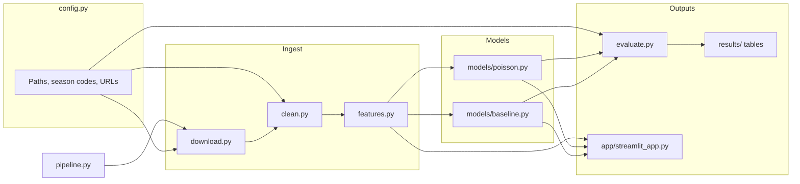

# Case study — Premier League Prediction Engine

## Problem

Analysts and curious fans often want match probabilities that are transparent and comparable to the market, not opaque tips. Rebuilding downloads, cleaning, and charts by hand each week is slow and easy to get wrong.

## What we built

A Python project that:

1. Downloads (or skips) season CSVs into `data/raw/`
2. Cleans them into `data/processed/matches.csv`
3. Fits a Poisson goals model and a scikit-learn baseline
4. Scores both on a fixed test season against naive frequencies and bookmaker implied odds
5. Serves the same logic through a Streamlit app and an optional Docker image

Architecture (same flow as the teaching syllabus):

## Data and models

- **Data:** football-data.co.uk Premier League (`E0`) files; raw files not committed.
- **Poisson:** team attack/defence style goals rates → home/draw/away probabilities.
- **Baseline:** logistic regression using bookmaker-implied features (fit on train only).
- **Bookmaker row:** normalised closing odds on the same test matches — a tough external baseline, not a “target to beat at all costs.”

## Results

On season `2526` (380 test matches; 1,140 train matches from prior seasons):

| Model | Log loss | Brier | Accuracy |
|-------|----------|-------|----------|
| Naive frequencies | 1.085 | 0.219 | 42.6% |
| Poisson | 1.041 | 0.209 | 45.0% |
| Sklearn baseline | 1.016 | 0.204 | 49.5% |
| Bookmaker implied | 1.013 | 0.203 | 49.7% |

Both models beat naive. Sklearn sits next to the bookmakers; Poisson improves on naive but trails the market slightly. Limitations: one league, simple features, no injuries/line-ups, and odds-based features mean the baseline is partly “learning the market,” not discovering independent edge.

## ROI / time-saved framing

There is no paying client here. The concrete win is engineering time: one pipeline command regenerates processed data and sample forecasts; one eval command regenerates a comparable metrics table; the dashboard and Docker path make the demo repeatable without re-explaining a personal laptop setup. That is hours of fragile notebook work turned into a short, documented runbook.

## Will it break?

- **Tests:** pytest covers cleaning/features/models/eval helpers.
- **Eval:** fixed train/test rule in `results/EVAL_README.md` — do not retune the split to chase scores.
- **Logging:** download/pipeline/evaluate use structured logs instead of silent failure.
- **Downloads:** idempotent skip if files exist; network failures surface as errors.
- **Leakage:** models fit on train only; features must not use future match results.
- **UI language:** probabilities and forecasts, not tips or certainties.
- **Secrets:** `.env` never baked into Docker images.

**Next (future scope, not this delivery):** scheduled evals, fixtures API token usage, richer models, multi-book odds — only when measured gains justify the work.
